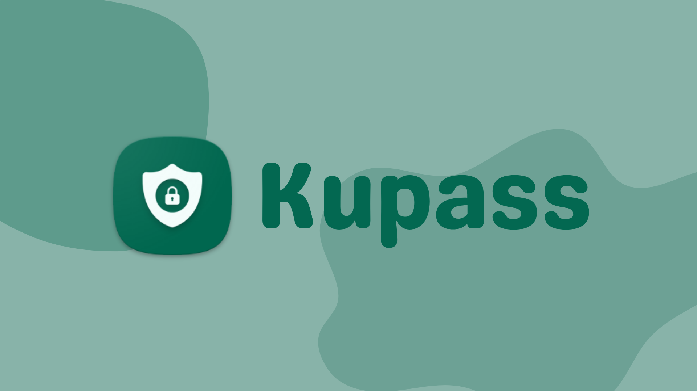
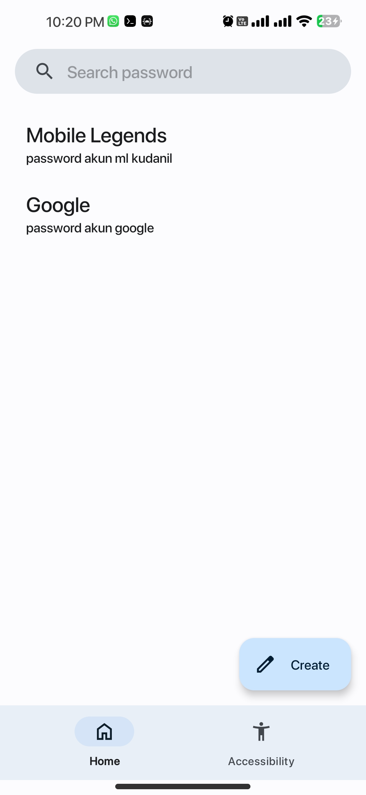
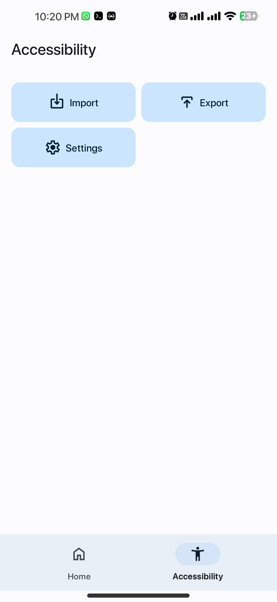
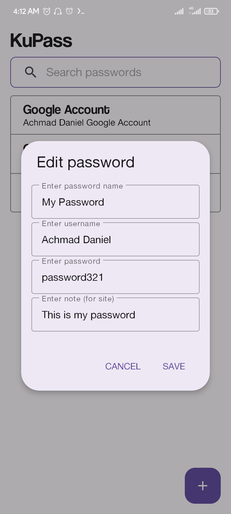
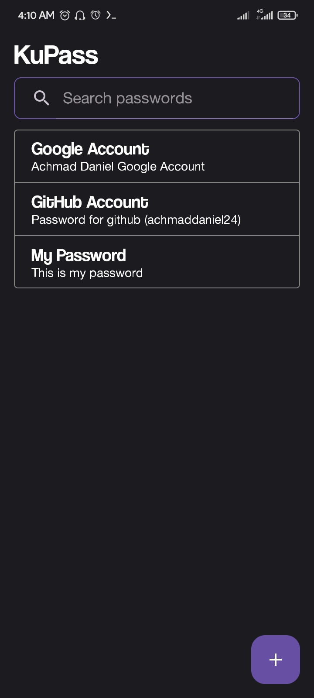
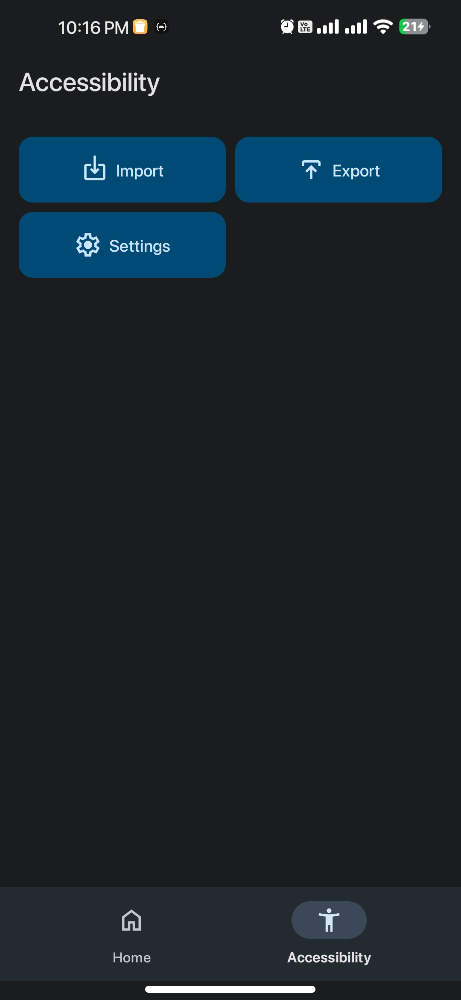
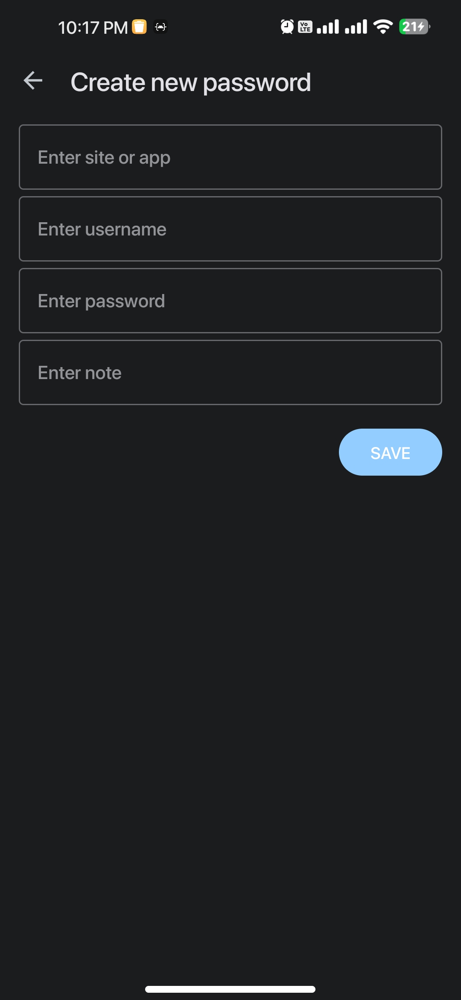

<p align="center">
	
</p>

# Kupass

Kupass is an offline, open-source password manager for Android. Your vault stays on your phone: Kupass has no account or cloud sync, and it doesn't collect analytics or crash reports.

## Features

- Every field of every entry (site name, username, password, URL, and notes) is encrypted with AES-GCM, using a key kept in the Android Keystore.
- Opening a saved account asks for your fingerprint, face, or screen lock. Other accounts then open without another prompt until Kupass has been in the background longer than the timeout you choose in Settings.
- Backups are `.kupass` files protected by a password you choose (PBKDF2-HMAC-SHA256 and AES-256-GCM), so you can restore them on a new phone or after reinstalling. Each export asks you to authenticate first.
- You can import a Kupass backup, an older Kupass JSON backup, or a Google Password Manager CSV export.
- Copied passwords are cleared from the clipboard after 45 seconds.
- Kupass blocks screenshots and screen recording, and Android cloud backup and device-to-device transfer skip the vault.
- The app comes in English and Indonesian, with light and dark themes and Material You dynamic color.

## Privacy

Kupass makes network requests only for site icons. For an entry with a public domain, it sends just that domain, such as `github.com`, to the Favget icon service and keeps the icon in memory. For an app entry, the domain comes from the app's name or its package name (`com.instagram.android` becomes `instagram.com`), and the package name itself is never sent. Usernames, passwords, notes, and full URLs are never sent. Favget and the CDN that serves the images can see which domains you have saved. When a site blocks Favget, the Favget server may ask Google's favicon service instead, so Google can see that domain too; the request comes from Favget, not from your phone.

[SECURITY.md](SECURITY.md) explains the security model, its known limitations, and how to report a vulnerability.

## Screenshots

### Light mode

<p align="center">
	
	
	
</p>

### Dark mode

<p align="center">
	
	
	
</p>

## Download

Download the APK from [GitHub Releases](https://github.com/kudanilll/kupass/releases). Kupass needs Android 8.1 (API 27) or newer.

If the release has a `.sha256` file next to the APK, download both into the same folder and check the APK before you install it:

```bash
sha256sum -c kupass-vX.Y.Z.apk.sha256
```

## Build from source

You need JDK 21 and the Android SDK with platform 37. Gradle finds the SDK through `ANDROID_HOME` or the `sdk.dir` line in `local.properties`, which Android Studio writes for you.

```bash
git clone https://github.com/kudanilll/kupass.git
cd kupass
./gradlew :app:assembleDebug
```

On Windows, use `gradlew.bat` instead of `./gradlew`. The APK is written to `app/build/outputs/apk/debug/app-debug.apk`, and `./gradlew :app:testDebugUnitTest` runs the unit tests.

Site icons need a Favget API key in a `secrets.properties` file at the repository root:

```properties
FAVGET_API_KEY=your-key
```

Without the key the build still works, and entries show a letter instead of an icon. When `release-key.jks` is missing, release builds are signed with the debug key, so only official releases carry the release signature. Never commit `secrets.properties` or a keystore.

Kupass is written in Kotlin with Jetpack Compose and Material 3, and stores the vault with Room. [`docs/codebase/`](docs/codebase) describes the architecture.

## Contributing

Issues and pull requests are welcome. Read [CONTRIBUTING.md](CONTRIBUTING.md) before you open a pull request, and report security problems privately as described in [SECURITY.md](SECURITY.md).

## Support

If you appreciate my work, you can [buy me a coffee](https://www.buymeacoffee.com/kudanil) and share your feedback. Your support helps me keep improving Kupass.

## License

This project is licensed under the GNU General Public License v3.0 (GPL-3.0). See the [`LICENSE`](LICENSE) file for the full text.

```
Copyright (C) 2023-present  Achmad Daniel Syahputra

This program is free software: you can redistribute it and/or modify
it under the terms of the GNU General Public License as published by
the Free Software Foundation, either version 3 of the License, or
(at your option) any later version.

This program is distributed in the hope that it will be useful,
but WITHOUT ANY WARRANTY; without even the implied warranty of
MERCHANTABILITY or FITNESS FOR A PARTICULAR PURPOSE.  See the
GNU General Public License for more details.
```
